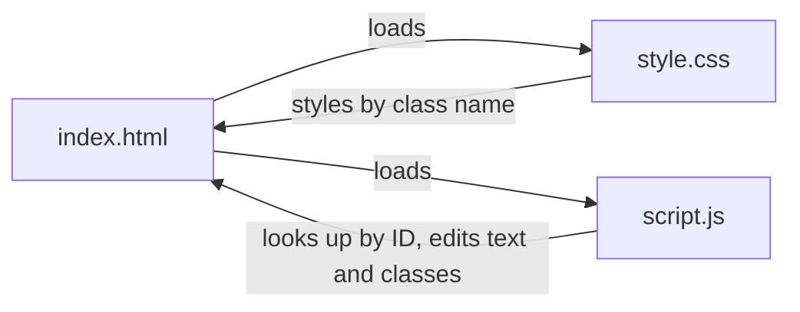

# Bluey Number Guessing Game: Project Map

## 1. Overview

A small, single-player, Bluey-themed number guessing game. The game picks a secret number from 1 to 100. The player has 5 guesses. After each guess the page says "Too high", "Too low" or "Correct". It always shows how many guesses remain. When the game ends, a win or lose pop-up appears. Closing the pop-up starts a fresh game automatically.

It is plain HTML, CSS and JavaScript. There is no build step and there are no dependencies, apart from the Google Fonts "Fredoka" font loaded from the internet (`index.html:7-9`). If the font cannot load, the CSS falls back to other fonts.

**How to run**
- Simplest: open `index.html` in a browser.
- Or serve it locally: `python3 -m http.server 8000` from the project root, then visit http://localhost:8000.

## 2. File map

| File | Single responsibility |
|---|---|
| `CLAUDE.md` | The product spec and project rules (the "what"). |
| `index.html` | Page structure: what elements exist. |
| `style.css` | Looks: Bluey colours, layout, pop-up styling, responsive rules. |
| `script.js` | Behaviour: all game logic. |
| `resources/number guessing wireframe.png` | The original design sketch. |
| `.claude/agents/qa-agent.md` | Browser-testing agent definition. |
| `.claude/agents/project-mapper.md` | Documentation-writing agent definition. |

The wireframe shows four screens: wrong guess, wrong guess with lose pop-up ("Try Again"), right guess, and right guess with win pop-up ("Play Again"). The built game follows it. Two things differ from the wireframe:
- **Hints:** the wireframe says "your guess was incorrect", but `CLAUDE.md` requires "Too high" / "Too low", so the game uses those.
- **Wording:** the pop-ups add Bluey-style text: "Hooray! Congrats, you guessed correctly!" and "Oh, biscuits! ...".

### index.html (48 lines)
- `index.html:7-9` Google Fonts preconnect and font link
- `index.html:10` links `style.css`
- `index.html:13-35` `<main class="card">`, the main game card
  - `index.html:14-20` paw decoration, title "Guess a Number", subtitle with the rules text
  - `index.html:22-29` guess form: label, number input, Guess button, feedback line
  - `index.html:31-34` "Remaining Guesses" display
- `index.html:37` `.hill`, a decorative grass hill
- `index.html:39-44` pop-up (starts `hidden`): backdrop, box, message, button
- `index.html:46` loads `script.js` last, so every element exists before the script looks it up

### style.css (244 lines)
- `style.css:1-11` colour variables in `:root` (`--bluey-light`, `--bluey-dark`, `--bingo-orange`, `--cream`, `--grass`, `--grass-dark`, `--red`, `--green`)
- `style.css:13-15` box-sizing reset
- `style.css:17-28` `body`: centres the card, blue sky gradient, font
- `style.css:31-41` `.hill`: fixed grass hill at the bottom
- `style.css:43-52` `.card`
- `style.css:54-77` paws, `h1`, subtitle, label
- `style.css:79-101` guess row and `#guess-input` (including focus style)
- `style.css:103-129` `button` (hover, active, disabled)
- `style.css:131-149` `.feedback` plus the states `.wrong`, `.warning`, `.correct`
- `style.css:151-170` remaining guesses label and orange count badge
- `style.css:172-224` pop-up: `.popup-backdrop` (183-185 makes `[hidden]` really hide it), `.popup`, `.popup.win`, `.popup.lose`, `.popup-message`, `@keyframes pop-in`
- `style.css:226-244` `@media (max-width: 400px)`: stacks the input and button vertically on small phones

### script.js (104 lines)
- `script.js:1-4` settings: `MIN_NUMBER`, `MAX_NUMBER`, `MAX_GUESSES`
- `script.js:6-9` state: `secretNumber`, `guessesLeft`, `popupOpenedAt`
- `script.js:11-20` element lookups
- `script.js:22-33` `startNewGame()`
- `script.js:35-38` `showFeedback(message, type)`
- `script.js:40-69` `handleGuess(event)`
- `script.js:71-89` `showPopup(playerWon)`
- `script.js:91-99` `closePopup()`
- `script.js:101-102` event listeners
- `script.js:104` first call to `startNewGame()`

## 3. How the pieces connect

```
index.html
 |-- <link href="style.css">   (line 10, in <head>): styles the elements
 |-- <script src="script.js">  (line 46, end of <body>): brings them to life

script.js --getElementById--> elements in index.html
script.js --sets textContent / className / hidden / disabled--> page changes
style.css --reacts to the class names script.js sets--> colours and visibility
```



### Element IDs that script.js looks up (`script.js:12-20`)

| ID | Element | What script.js does with it |
|---|---|---|
| `guess-form` | `<form>` | Listens for `submit` (Enter key or Guess button). |
| `guess-input` | number input | Reads the guess, clears it, disables or enables it, focuses it. |
| `guess-button` | Guess button | Disabled while the pop-up is showing. |
| `feedback` | `<p>` (aria-live) | Shows "Too high / Too low / Correct / invalid" messages. |
| `remaining-count` | `<p>` | Shows guesses left. |
| `popup` | backdrop `<div>` | Shown or hidden via the `hidden` attribute. |
| `popup-box` | inner dialog | Gets class `popup win` or `popup lose`. |
| `popup-message` | `<p>` | Receives the win or lose text. |
| `popup-button` | `<button>` | Label set to "Play Again" or "Try Again"; click closes the pop-up. |

### CSS classes toggled by script.js
- Feedback, in `showFeedback` (`script.js:37`): `feedback` plus one of:
  - `wrong` (red, `style.css:138`) for too high or too low
  - `warning` (orange, smaller text, `style.css:142`) for invalid input
  - `correct` (green, `style.css:147`) for a right guess
  - an empty type string clears the colour
- Pop-up box, in `showPopup` (`script.js:76`, `script.js:80`): `popup win` (green, `style.css:197`) or `popup lose` (red, `style.css:202`).
- Pop-up visibility is not a class. It uses the `hidden` attribute (`script.js:86`, `script.js:97`), with `style.css:183` making sure it actually hides.

## 4. Game flow walkthrough

1. **Page load.** The browser reads `index.html`, applies `style.css`, then runs `script.js`. The script registers two listeners (`script.js:101-102`) and calls `startNewGame()` (`script.js:104`).
   - `startNewGame()` picks `secretNumber` with `Math.floor(Math.random() * MAX_NUMBER) + MIN_NUMBER` (`script.js:24`). It sets `guessesLeft` to 5, updates the counter, clears the feedback (via `showFeedback("", "")`) and the input, re-enables the input and button, and focuses the input.
2. **Player submits a guess.** The form `submit` event runs `handleGuess` (`script.js:40`). It calls `event.preventDefault()` so the page does not reload. It reads `Number(input.value)`.
3. **Invalid guess** (`script.js:46-50`): empty, not a whole number, or outside 1 to 100.
   - `showFeedback(..., "warning")` shows "Please enter a whole number from 1 to 100."
   - The input text is selected and the function returns. **No guess is used up.**
4. **Valid guess.** `guessesLeft--` and the counter updates (`script.js:52-53`). Then:
   - Correct (`script.js:55`): feedback "Correct!" (`correct`), then `showPopup(true)`.
   - Out of guesses (`script.js:58`): "Too high!" or "Too low!" (`wrong`), then `showPopup(false)`.
   - Too high (`script.js:61`) or too low (`script.js:63`): hint message (`wrong`), and play continues.
   - The input is then cleared and refocused, but only if the pop-up is not showing (`script.js:67-68`).
5. **Pop-up.** `showPopup(playerWon)` (`script.js:71`) disables the input and Guess button. It then sets the box class, message and button label:
   - Win: "Hooray! Congrats, you guessed correctly!" with "Play Again".
   - Lose: "Oh, biscuits! Sorry, you did not guess in time. The number was N." with "Try Again". This reveals the secret number.
   - It un-hides the pop-up, records `popupOpenedAt = Date.now()` (`script.js:87`), and focuses the pop-up button.
6. **Closing.** Clicking the button runs `closePopup()` (`script.js:92`). It hides the pop-up and calls `startNewGame()`, so a new game starts automatically.

### The 1-second click guard (`popupOpenedAt`)
`closePopup()` begins with `if (Date.now() - popupOpenedAt < 1000) return;` (`script.js:95`).

Why it exists: when the pop-up opens, focus moves to its button. If the player presses Enter twice quickly, the first Enter submits the final guess and the second Enter lands on the freshly focused pop-up button. That counts as a click, so the pop-up would close at once and the player would never read the win or lose message. The guard ignores any click in the first second after the pop-up opens, giving the player time to read it.

## 5. "Where do I change...?" quick reference

| I want to change... | Go to |
|---|---|
| Number range (min, max) | `script.js:2-3`. Also update the text in `index.html:18` and `index.html:25` (`min`/`max`), the error message at `script.js:47`, and `CLAUDE.md`. |
| Number of guesses | `script.js:4`. Also update `index.html:19` (subtitle) and `index.html:33` (initial "5"). |
| "Too high" / "Too low" / "Correct" messages | `script.js:56`, `59`, `62`, `64` |
| Invalid-input message | `script.js:47` |
| Win pop-up text and button | `script.js:77-78` |
| Lose pop-up text and button | `script.js:81-83` |
| Pop-up close delay (1 second) | `script.js:95` (the `1000`) |
| Page title and intro text | `index.html:15-19` (the browser tab title is `index.html:6`) |
| Palette (Bluey colours) | `style.css:2-11` |
| Feedback colours | `style.css:138-149` |
| Win and lose pop-up colours | `style.css:197-205` |
| Card look | `style.css:43-52` |
| Grass hill | `style.css:31-41` |
| Font | `index.html:9` and `style.css:24` |
| Small-phone layout | `style.css:226-244` |
| Pop-up entrance animation | `style.css:194` and `style.css:215-224` |

Note: the guess count and range appear in several places (JS constants, HTML text, the initial "5", the error message). Change them all together so the page text matches the game.

## 6. Plain-English analogies

- **HTML is the skeleton or a stage set.** It decides what is on stage: a title, a box to type in, a button, a score counter.
- **CSS is the costumes, paint and lighting.** The same stage can look like Bluey's backyard or a grey office, depending on colours and fonts.
- **JavaScript is the referee.** It thinks of the secret number, counts your turns, calls "too high" or "too low", and blows the whistle when the game is over.
- **The element IDs are name tags.** The referee finds each actor by the name tag on their shirt (`guess-input`, `feedback`...).
- **The CSS classes are costume changes.** When the referee shouts "wrong!", the feedback actor swaps into the red costume. "Correct!" gets the green one.
- **The pop-up is a curtain call.** It appears when the show ends, and closing it resets the stage for the next round.
- **The 1-second guard is a "no skipping the announcement" rule.** The announcer finishes the result before anyone may wave it away.
- **The wireframe is the architect's sketch,** drawn before any building started.
- **CLAUDE.md is the rulebook the whole team agrees on** before building.

## 7. Tooling (`.claude/agents/`)

### qa-agent (`.claude/agents/qa-agent.md`)
- Model: `opus`. Tools: `mcp__playwright__*`.
- Role: a Quality Assurance tester. It uses the Playwright MCP server to open a browser page and check a feature list. It also checks that the layout adapts well to both mobile and desktop.
- Inputs: (1) the browser URL where the project is hosted, for example the `python3 -m http.server 8000` address, and (2) a list of features to test.
- **Setup requirement:** the tools pattern `mcp__playwright__*` only matches if Playwright is added directly as an MCP server named `playwright`:
  ```
  claude mcp add playwright -- npx @playwright/mcp@latest
  ```
  If Playwright is installed as a plugin instead, its tools are named `mcp__plugin_playwright_playwright__*`. These do not match the pattern, and the agent will have no browser tools.

### project-mapper (`.claude/agents/project-mapper.md`)
- Model: `sonnet`. Tools: `Read, Grep, Glob` (read-only).
- Role: acts as the Technical Lead. It scans the codebase and produces documentation (this kind of map) covering layout, how components connect, and non-technical analogies. It follows the Single Responsibility Principle to document each piece efficiently.

## Notes for maintainers
- `CLAUDE.md` says to keep the game simple, add no unrequested features, and explain major gameplay changes before making them.
- Line numbers in this map reflect the code at the time of writing. Re-run the project-mapper agent after changes to refresh them.
